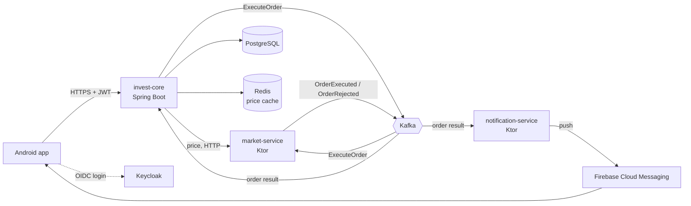
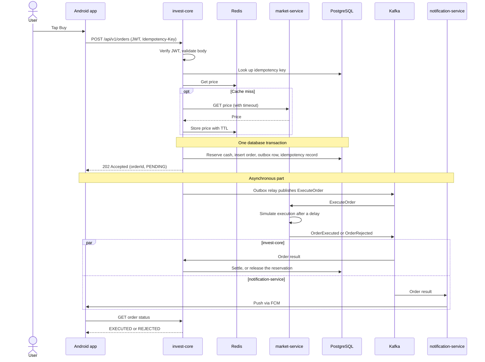

# MiniInvest – Architecture

MiniInvest is a simplified investment platform: a user has a cash account, buys ETFs, sees a portfolio and gets a push notification when an order is executed. It is a learning project and an interview demo, so the scope is deliberately small, but every part of the main flow is built the way a production system would build it.

This document describes the **target architecture of the demo**. Parts that are not implemented yet are marked with the course module where they arrive.

## 1. Scope

| In scope | Out of scope (for now) |
|---|---|
| Buying an ETF with a market order by quantity, including fractional quantities | Selling, limit orders, cancelling orders, buying for an amount of money |
| Portfolio and order status | Fees, taxes, FX conversion |
| Push notification about the result | Real exchange or broker connection |
| One market (CZ, CZK); the contract is designed for several markets from day one (see section 6) | A second market in the demo (stretch goal, demo scenario 5) |
| Everything runs locally in Docker Compose | Kubernetes, cloud deployment |

Simplifications that are intentional and worth saying out loud in the demo:

- **market-service simulates the exchange.** It generates prices and executes orders after a random delay. In a real platform this would be an adapter to a broker or exchange, often over FIX.
- **One currency per market, no FX.** A CZ account holds CZK, an SK account EUR, and instruments offered in a market are priced in its currency.
- **One PostgreSQL instance.** Each service that needs a database gets its own schema; no service reads another service's tables. In production this would typically be a separate managed database per service, each with a primary, replicas in other data centres and automatic failover.
- **Single instance of each service** in Docker Compose. The design does not depend on it: services are stateless and can run as several instances (see section 8).

## 2. Components



| Component | Technology | Responsibility | Module |
|---|---|---|---|
| Android app | Kotlin, Compose, Flow | Two screens: portfolio and buy. Generates the idempotency key, shows order states, receives push. | Milestone 1 |
| invest-core | Spring Boot, PostgreSQL | Modular monolith with modules Accounts, Orders and Portfolio. Cash, reservations, orders, positions, outbox. | 4, 6, 7, 11 |
| market-service | Ktor | Instrument catalogue and prices over HTTP. Simulated execution over Kafka. Demo controls (pause, reject, latency). | 5, 12 |
| notification-service | Ktor | Reacts to order results and sends push via FCM. | 12 |
| PostgreSQL | | Source of truth for money, orders and positions. | 6, 7 |
| Redis | | Short-lived price cache. Never a source of truth. | 9 |
| Kafka | KRaft mode, single broker | Commands to market-service and events about results. | 12, 13 |
| Keycloak | | Issues JWTs for the app; one realm, test users. | 10 |
| Tracing | OpenTelemetry Java agent, Jaeger | One trace per purchase across HTTP and Kafka; source data for the demo. | 15 |
| mobile-bff | Spring Boot | Stretch goal: screen-shaped API, app versions and markets. | 13B |

Why the split looks like this:

- **Accounts, Orders and Portfolio are modules of one application**, because reserving cash and storing an order must happen in one database transaction.
- **market-service is separate** because it plays the outside world. That forces the system to handle timeouts, outages and duplicates.
- **notification-service is separate** because it shares no transaction with the purchase. When it is down, purchases still work.

## 3. Buy flow



### Synchronous part

**S1. The app sends the order.** The app generates one UUID per purchase intent and reuses it for every retry of that purchase.

```http
POST /api/v1/orders
Authorization: Bearer <JWT>
Idempotency-Key: 6f1c2a9e-1d0b-4b8e-9a51-3c2f0f1e7a42
Content-Type: application/json

{ "isin": "IE00B4L5Y983", "side": "BUY", "quantity": "2.5" }
```

The body carries only what the user decided: what and how much. The account comes from the token, the market and currency from the account, and the price from the server's own source, never from the client. The quantity is a decimal string, like money, so fractional shares need no special format.

**S2. Routing.** DNS and TLS, then the load balancer sends the request to any invest-core instance. Any instance can handle it because no state lives in instance memory.

**S3. Authentication and validation.** Spring Security verifies the JWT signature and expiry against Keycloak's public keys before the controller is reached (401 if invalid). Then Jackson maps the body and Bean Validation checks its shape: a valid ISIN, a known side and a positive decimal quantity (400 with `application/problem+json` and code `VALIDATION_FAILED` if not).

**S4. Idempotency check.** invest-core looks up `(user, Idempotency-Key)`.
- Found with the same request body: return the stored response, do nothing else.
- Found with a different body: 422 with code `IDEMPOTENCY_KEY_REUSED`.
- Not found: continue. Two identical requests arriving at the same moment are caught by the unique constraint in S6.

The body fingerprint is computed from the parsed request with the quantity normalized, so `"5"` and `"5.0"` are the same request.

**S5. Business checks and price.** The checks run after the idempotency check, so a retry of an accepted order always gets its stored response, even if the offer changed in between.
- The instrument must be offered in the user's market, otherwise 422 with code `INSTRUMENT_NOT_AVAILABLE`.
- The quantity must be at least the instrument's `minQuantity` and a multiple of its `quantityStep`, otherwise 422 with code `QUANTITY_NOT_ALLOWED`. An instrument with step `1` allows whole units only, so fractional shares can be enabled per instrument or market without a contract change.

Then read the price from Redis. On a cache miss call market-service with a short timeout and store the result with a TTL of a few seconds. If market-service does not answer, reject with 503, code `PRICE_UNAVAILABLE` and `Retry-After`. The reserved amount is an estimate, `price × quantity` plus a configurable buffer, rounded up to the decimal places of the currency, because the execution price will differ.

**S6. One database transaction.**
1. Reserve cash with a conditional update, so two concurrent purchases cannot spend the same money:
   `UPDATE account SET reserved = reserved + :amount WHERE id = :id AND balance - reserved >= :amount`
   Zero updated rows means insufficient funds: roll back and return 422 with code `INSUFFICIENT_FUNDS`.
2. Insert the order with status `PENDING`.
3. Insert an `ExecuteOrder` message into the `outbox` table, including the current `traceparent`.
4. Insert the idempotency record with the response.

Either all four rows exist after commit, or none.

**S7. Response.** `202 Accepted` with `Location: /api/v1/orders/{id}` and the order in the same shape as `GET /api/v1/orders/{id}` returns it. The app shows "waiting for execution".

```json
{
  "orderId": "d3b07384-9a1f-4c1e-8f7a-2b4c6e8d0a11",
  "side": "BUY",
  "isin": "IE00B4L5Y983",
  "quantity": "2.5",
  "status": "PENDING",
  "reservedAmount": { "amount": "1330.00", "currency": "CZK" },
  "executionPrice": null,
  "rejectionCode": null,
  "createdAt": "2026-10-31T22:27:00Z",
  "updatedAt": "2026-10-31T22:27:00Z"
}
```

**Why 202 and not 200:** at the moment of the response the order is accepted but not executed; execution takes time and can fail, and waiting for it would hold the connection, a thread and a transaction while making every purchase depend on the exchange being up.

### Asynchronous part

**A1. Outbox relay.** A scheduled job in invest-core reads unsent outbox rows, publishes them to `orders.commands` with the account ID as the key, and marks them as sent. It restores the stored `traceparent`, so the trace continues across the gap. Delivery is at least once.

**A2. Execution.** market-service consumes `ExecuteOrder`, skips order IDs it has already processed, waits a random delay and publishes `OrderExecuted` (with execution price) or `OrderRejected` (with reason) to `orders.events`, again keyed by account ID. It commits the Kafka offset only after publishing the result.

**A3. Settlement or compensation.** invest-core consumes the result. Each event is processed once (event ID stored in `processed_events`) and only a `PENDING` order can change state. In one transaction:
- `OrderExecuted`: add or increase the position, deduct the actual cost from the balance, release the reservation, order → `EXECUTED`.
- `OrderRejected`: release the reservation (compensation), order → `REJECTED` with the reason.

**A4. Notification.** notification-service reads the same events in its own consumer group, skips duplicates by event ID and sends a push via FCM. invest-core does not know it exists.

**A5. Status in the app.** The app refreshes the order with `GET /api/v1/orders/{id}` when the push arrives and when the screen opens. Push is not guaranteed, so the API is the source of truth for the app.

Order states: `PENDING → EXECUTED` or `PENDING → REJECTED`.

## 4. Failure analysis

| Step | Type | What fails | Reaction | Module |
|---|---|---|---|---|
| S1 | Sync, HTTP | Network drops, the app does not know if the order was accepted | App retries with the same Idempotency-Key, server returns the original response | 1, 13B |
| S1 | Sync, HTTP | Double tap or retry sends two identical requests at once | Unique constraint on `(user, key)`; the second request gets the same response, or 409 while the first is still in progress | 1, 7 |
| S2 | Sync | An instance dies mid-request | Health checks take it out of rotation; the client retries safely thanks to idempotency | 14 |
| S3 | Sync | Token invalid or expired | 401, the app refreshes the token | 10 |
| S3 | Sync | Invalid body | 400 with problem details and code `VALIDATION_FAILED`, nothing stored | 1 |
| S5 | Sync | Instrument not offered in the user's market, or quantity below the minimum or off the step | 422 with code `INSTRUMENT_NOT_AVAILABLE` or `QUANTITY_NOT_ALLOWED`, nothing stored | 1 |
| S5 | Sync, cache | Redis is down | Fall back to market-service; Redis is only a cache | 9 |
| S5 | Sync, HTTP | market-service slow or down | Timeout and circuit breaker; 503 with code `PRICE_UNAVAILABLE` and Retry-After; never wait without a limit | 4, 13 |
| S6 | Sync, DB | Insufficient funds | Conditional update changes 0 rows, rollback, 422 with code `INSUFFICIENT_FUNDS` | 6, 7 |
| S6 | Sync, DB | Database down or commit fails | Nothing is stored (atomic), 503, client retries with the same key | 7 |
| S6→S7 | Sync | invest-core crashes after commit, before responding | Client times out and retries; the idempotency record returns the original 202 | 1, 7 |
| A1 | Async, Kafka | Kafka is down | Rows stay unsent, relay retries; the order is just PENDING longer | 13 |
| A1 | Async, Kafka | Relay crashes after publishing, before marking sent | Message is published twice; market-service skips it by order ID | 13 |
| A2 | Async | market-service is down or paused | Commands wait in Kafka, consumer lag grows, nothing is lost (demo scenario 3) | 12 |
| A2 | Async | market-service crashes after publishing the result, before committing the offset | Command is redelivered and skipped; the result may be duplicated and invest-core skips it | 12, 13 |
| A2 | Async | Exchange rejects the order | `OrderRejected` triggers compensation (demo scenario 4) | 13 |
| A3 | Async | Duplicate or late event | `processed_events` and the `PENDING`-only state guard make processing idempotent | 13 |
| A3 | Async | Event cannot be processed (bug, bad data) | Limited retries, then dead letter topic `orders.events.dlt` and an alert | 12 |
| A3 | Async | No result for a long time | Order stays PENDING and is reported; a real system would reconcile with the exchange | 13 |
| A4 | Async | notification-service is down | Events wait; push arrives late; purchases are not affected | 12 |
| A4 | Async | FCM fails | Retry with backoff, then dead letter topic; the app still shows the right state via the API | 12, 13B |
| A5 | Async | Push never arrives | The app refreshes status from the API on screen open | 13B |

## 5. Data model of invest-core

Money is stored as `NUMERIC` with an explicit currency, never as floating point. Quantities are `NUMERIC` too, because fractional shares are allowed.

| Table | Key columns | Notes |
|---|---|---|
| `account` | `id`, `owner_id`, `market`, `currency`, `balance`, `reserved` | Available cash = `balance − reserved`; market and currency are fixed for the account |
| `orders` | `id`, `account_id`, `isin`, `side`, `quantity`, `currency`, `status`, `reserved_amount`, `execution_price` | Status: PENDING, EXECUTED, REJECTED; amounts in `currency`; `quantity` may be fractional |
| `position` | `account_id`, `isin`, `quantity`, `average_price` | One row per instrument; price in the account currency; `quantity` may be fractional |
| `idempotency_key` | `owner_id`, `key`, `request_hash`, `response`, `created_at` | Unique on `(owner_id, key)`, cleaned up after 72 hours |
| `outbox` | `id`, `type`, `payload`, `traceparent`, `created_at`, `sent_at` | Read by the relay |
| `processed_events` | `event_id`, `processed_at` | Consumer deduplication |

## 6. Contracts

**REST (invest-core)**

| Endpoint | Purpose |
|---|---|
| `POST /api/v1/orders` | Place an order (needs `Idempotency-Key`) |
| `GET /api/v1/orders` | Order history, newest first, with cursor pagination |
| `GET /api/v1/orders/{id}` | Order status |
| `GET /api/v1/portfolio` | Cash and positions |
| `GET /api/v1/instruments` | Instruments offered in the user's market, with prices, minimum quantity and quantity step |

The full contract is in [`contracts/invest-core/openapi.yaml`](../contracts/invest-core/openapi.yaml) (OpenAPI 3.1). The rules every endpoint follows are in [`api-guidelines.md`](api-guidelines.md).

**REST (market-service, internal)**: `GET /api/v1/instruments?market=CZ` (the offer of a market, including `minQuantity` and `quantityStep` of each instrument) and `GET /api/v1/instruments/{isin}/price`. Only invest-core calls it; the app never talks to market-service directly.

**Kafka**

| Topic | Messages | Key |
|---|---|---|
| `orders.commands` | `ExecuteOrder` | account ID, so orders of one account stay in order |
| `orders.events` | `OrderExecuted`, `OrderRejected` | account ID |
| `orders.events.dlt` | events that could not be processed | account ID |

Every message carries `eventId`, `type`, `orderId`, `occurredAt` and the `traceparent` header. Money fields use the same `{ amount, currency }` format as the REST API, and quantities the same decimal string.

### Designed for several markets

The app stays in users' phones for months and old versions cannot be forced to update. The contract is therefore designed so that adding a market (SK, then others in CEE) needs no contract change and no new app version.

| Rule | Example | Why |
|---|---|---|
| Money always carries its currency; the amount is a decimal string | `{ "amount": "1234.50", "currency": "CZK" }` | No implicit default currency, no floating-point rounding |
| Quantity is a decimal string; each instrument states its minimum and step | `"quantity": "2.5"`, `"quantityStep": "0.0001"` | Fractional shares can be enabled per market or instrument as data; a step of `1` means whole units only |
| The market is a property of the account, never a request parameter | The server resolves CZ or SK from the user's account | The client must not decide where it trades, same as with the account ID or the price |
| The instrument catalogue is filtered by the user's market | `GET /api/v1/instruments` returns a different offer for CZ and SK | The app has no hardcoded list of products |
| Errors carry a stable machine-readable code | `application/problem+json` with `"code": "INSUFFICIENT_FUNDS"` | The app maps codes to texts in the user's language |
| Enums are open for extension | An unknown order status is shown as "processing" | A new value on the server does not break old app versions (demo scenario 6) |

Adding a market is server-side data and configuration: the market and its currency, its instrument offer and its rules, including whether fractional shares are allowed.

## 7. Demo

Demo controls in market-service, available only locally: pause the consumer, reject the next order, add latency to price requests.

| # | Scenario | How it is triggered | What the audience sees |
|---|---|---|---|
| 1 | Happy path | Buy in the app | PENDING, then push and EXECUTED; full trace across HTTP and Kafka |
| 2 | Double submit | Send the same request twice with the same key | One order, one reservation, the same response twice |
| 3 | market-service outage | Pause the consumer, then resume | Order waits in PENDING, consumer lag grows, then drains |
| 4 | Rejection | "Reject next order" switch | Reservation released, readable error in the app |
| 5 | New market (stretch) | Log in as a user with an SK account | EUR amounts and a different offer, same app version and contract |
| 6 | Old app version (stretch) | Add a new order state, run app v1 | v1 keeps working |

The presentation has three parts:

1. **Animation (2–3 min).** A standalone web page explains the buy flow step by step. It is an explanation aid and is not connected to the running system, so it must be kept in sync with this document.
2. **Live happy path (2–3 min).** A real purchase from the app, followed by the same request in Jaeger UI. The trace across HTTP, PostgreSQL and Kafka shows that the animation describes the real system.
3. **Live failures (4–5 min).** Scenarios 2–4 triggered for real. Consumer lag is visible in a Kafka UI or with `kafka-consumer-groups.sh --describe`.

A walkthrough replayed from trace data is not planned for now; Jaeger UI covers that role.

## 8. Running several instances (optional)

The demo runs one instance of each service. Running several instances of every service would add work without showing anything new. One exception is worth it as a bonus once scenarios 1–4 are stable: **a second invest-core instance**.

**What it demonstrates:** demo scenario 2 with two identical requests arriving at the same moment on two *different* instances. No in-memory check can help, and the second purchase is stopped only by the unique constraint on `(owner_id, key)` in the database. That is the strongest proof that the services are really stateless.

**What it requires:**

| Addition | Why |
|---|---|
| A load balancer in Docker Compose (nginx or Traefik) | Something has to spread requests across the instances |
| `SELECT … FOR UPDATE SKIP LOCKED` in the outbox relay | Otherwise both instances read and publish the same outbox rows |
| At least two partitions in `orders.events` | Two instances in one consumer group split partitions; with a single partition the second instance stays idle |

Until then the design already accounts for it: stateless services, the unique constraint for idempotency and idempotent consumers.

## 9. Delivery plan

| Phase | Goal | Content |
|---|---|---|
| 1 (Milestone 1) | Synchronous part works end to end | invest-core with PostgreSQL, Flyway, idempotency, reservation in one transaction, outbox rows written; market-service prices over HTTP; Redis cache; Android screens; tracing with the Java agent |
| 2 (Milestone 2) | Demo scenarios 1–4 | Kafka, outbox relay, simulated execution, settlement and compensation, notification-service with FCM, Keycloak, demo controls, CI with tests |
| 3 (optional) | Stretch | Second invest-core instance behind a load balancer, second market, mobile-bff and contract versioning, Kubernetes |

## 10. Key decisions

| Decision | Why | Trade-off |
|---|---|---|
| Modular monolith for invest-core | Cash and orders need one transaction | Module boundaries must be enforced (Spring Modulith) |
| Outbox with a polling relay | Solves dual write without extra infrastructure | Small delay and DB load; Debezium (CDC) would be the next step |
| At-least-once delivery with idempotent consumers | Simple and robust | Every consumer must deduplicate |
| Account ID as the Kafka key | Orders of one account are processed in order | A very active account cannot be spread across partitions |
| Reserve an estimate with a buffer | Market order price is unknown when the order is placed | The difference is settled after execution |
| Redis only for prices, never for balances | Stale data is acceptable for a price quote, not for money | Price can be a few seconds old |
| Market from the account, currency in every amount | A new market needs no contract change and no new app version | Every amount must carry its currency; there is no implicit default |
| Quantity as a decimal string with a per-instrument minimum and step ([ADR 0001](adr/0001-order-quantity-format.md)) | Fractional shares are common in investment apps; changing a number to a string later would break old app versions | Clients parse quantities as decimals; reservation and settlement need explicit rounding rules |
| Business checks return 422, shape validation 400 | The app can tell "fix the request" from "the request is fine but not allowed" | The split must be kept consistently across the API |
